# Reverse Aging – Routinen für ein starkes Älterwerden

> **Worum es geht:** Muskelkraft gehört zu den am besten beeinflussbaren Faktoren gesunden Älterwerdens. Diese Seite übersetzt das in Routinen: was täglich, wöchentlich und einmal pro Quartal zu tun ist – jeweils mit Herkunft und Evidenz. „Reverse Aging“ steht hier für beeinflussbare Altersfolgen wie Kraft, Funktion und Gleichgewicht, nicht für ein Versprechen der Verjüngung.

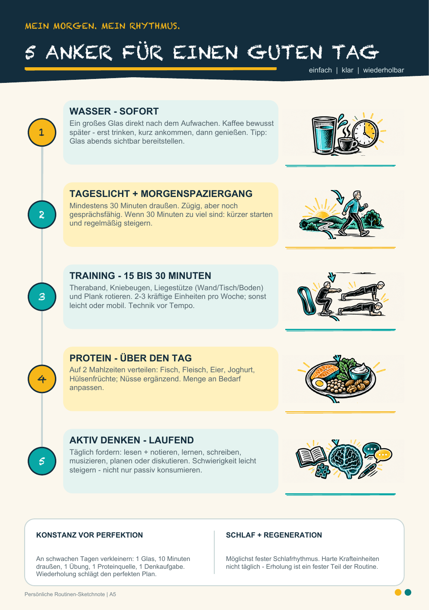

## Auf einen Blick

| Rhythmus | Routine | Umfang | Herkunft und Evidenz |
|---|---|---|---|
| täglich | Morgenroutine mit fünf Ankern | über den Vormittag verteilt | [Redaktioneller Vorschlag] |
| 2 × pro Woche | Krafttraining für den ganzen Körper daheim (Pfad A): Langhantel, Kurzhanteln, Klimmzugstange, Theraband | je etwa 45 Minuten | [Fachliteratur] gut belegt[^veryold][^who] |
| über die Woche | Ausdauer, moderat oder intensiv | 150–300 Minuten moderat oder 75–150 Minuten intensiv | [Fachliteratur] WHO-Empfehlung[^who] |
| an 3 Tagen pro Woche (ab 65) | Gleichgewicht und Kraft kombiniert | kurz, in Training oder Alltag eingebaut | [Fachliteratur] WHO-Empfehlung[^who] |
| jede Nacht | Schlaf | 7–9 Stunden (26–64 Jahre), 7–8 Stunden (ab 65) | [Fachliteratur][^nsf] |
| täglich | Protein auf die Mahlzeiten verteilt | 0,8 g/kg (19–64 Jahre), 1,0–1,2 g/kg (ab 65) pro Tag | [Fachliteratur][^dge][^protage] |
| optional | Kreatinmonohydrat zusätzlich zum Training | nach eigener Abwägung | [Fachliteratur] moderat belegt[^creatine-meta] |
| vierteljährlich | Selbsttests: Aufstehen, Gleichgewicht, Gehtempo | etwa 10 Minuten | [Fachliteratur][^steadi-chair][^ewgsop2] |
| als Kür | Pfad B: Calisthenics in drei Levels | wenn Pfad A sicher sitzt | [Magazin][^calisthenics] |

> **Keine medizinische Beratung.** Bei Brustschmerz, ungeklärter Atemnot, Schwindel, Herz-Kreislauf-Erkrankung, frischer Operation oder ausgeprägter Gebrechlichkeit vor intensivem Training ärztlich oder physiotherapeutisch abklären. Details stehen bei den [Sicherheitsgrenzen](#praktische-sicherheitsgrenzen).

## Täglich: Morgenroutine

### Fünf Anker für einen guten Tag

Die Morgenroutine ist bewusst kompakt. Sie verbindet Flüssigkeit, Tageslicht, Bewegung, Ernährung und geistige Aktivität zu einer Reihenfolge, die sich ohne komplizierte Vorbereitung wiederholen lässt.

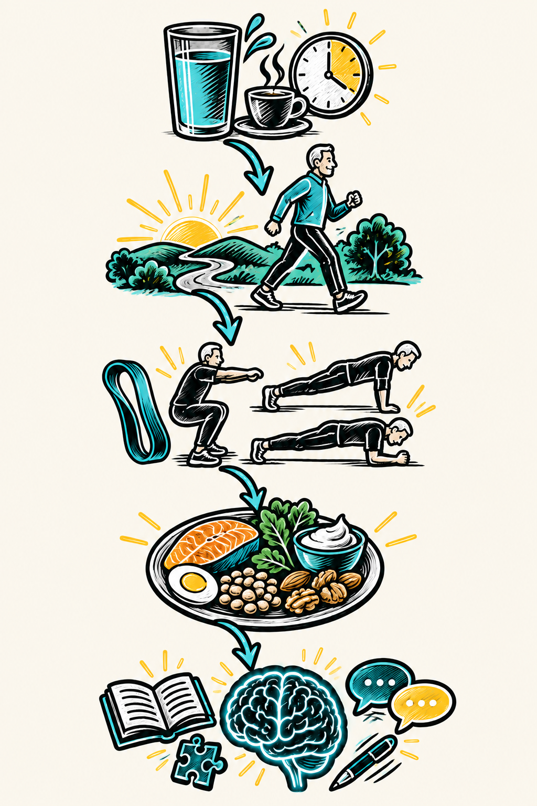

| Anker | Umsetzung |
|---|---|
| 1 · Wasser | Direkt nach dem Aufwachen ein volles Glas Wasser trinken. Kaffee erst später. |
| 2 · Tageslicht | Früh nach draußen gehen und möglichst rund 30 Minuten Tageslicht mitnehmen. |
| 3 · Training | 15–30 Minuten Muskeln fordern, zum Beispiel mit Theraband, Kniebeugen, Liegestützen oder Planking. |
| 4 · Protein | Auf zwei Mahlzeiten verteilen: Fisch, Fleisch, Eier, Joghurt oder Hülsenfrüchte; Nüsse ergänzend. Menge an den Bedarf anpassen. |
| 5 · Aktiv denken | Anspruchsvolle Tätigkeiten bewusst in den Tag holen – nicht nur passive Bildschirmzeit. |

**Zum Ausdrucken:** Die einseitige A5-Fassung liegt im Projektordner Routinen (`outputs/morgenroutine-a5.pdf`).

Anker 3 (Training) und Anker 4 (Protein) sind unten ausführlicher beschrieben: [Wöchentlich: Kraft](#wochentlich-kraft) und [Ernährung](#ernahrung).

### Die Routine flexibel nutzen

- **Minimum-Version:** Wasser, fünf Minuten vor die Tür und eine kurze Bewegungsserie.
- **Normale Version:** Alle fünf Anker in ruhiger Folge über den Vormittag verteilen.
- **Guter Tag:** Die Routine nicht „nachholen“, sondern am nächsten Morgen wieder einsteigen.
- **Anpassung:** Umfang und Belastung sollen zum tatsächlichen Alltag passen; die Reihenfolge ist wichtiger als Perfektion.

## Wöchentlich: Kraft

**Kurzurteil:** Zwei Ganzkörpereinheiten pro Woche mit schrittweiser Steigerung sind die tragende Säule. Krafttraining steigert die Kraft auch im hohen Alter deutlich; welches Programm genau, ist zweitrangig, solange es regelmäßig und progressiv ist.[^veryold][^who]

| Pfad | Für wen | Ausrüstung | Herkunft |
|---|---|---|---|
| A · Kraft daheim | dauerhafte Basis | Langhantel mit Ablageständer, Kurzhanteln, Klimmzugstange, Theraband, Matte | [Redaktioneller Vorschlag] |
| B · Calisthenics in drei Levels | Kür, wenn Pfad A sicher sitzt | Klimmzugstange, Barren, Matte | [Magazin] |

> **So ist der Plan zu lesen:** Pfad A ist eine redaktionelle Zusammenstellung dieser Seite. Er folgt der WHO-Empfehlung, alle großen Muskelgruppen an mindestens zwei Tagen pro Woche zu kräftigen,[^who] und Gießings Grundsätzen aus Interviews (wenige, kontrollierte Sätze; Abbruch kurz vor der Erschöpfung; zwei Einheiten pro Woche).[^big5][^medpertise] Er ist kein Buchplan und keine individuelle medizinische Trainingsverordnung.

### Pfad A: Kraft daheim mit Hanteln und Theraband

**[Redaktioneller Vorschlag]** Zwei Einheiten pro Woche an nicht aufeinanderfolgenden Tagen, zum Beispiel Montag und Donnerstag, je etwa 45 Minuten inklusive Aufwärmen. Zusammen decken beide Einheiten die Grundbewegungen ab: Beugen, Heben, Drücken, Ziehen und Rumpfspannung. Pausen zwischen den Sätzen: 1–2 Minuten, bei Kniebeuge und Kreuzheben auch länger.

**Einheit 1**

| Übung | Beansprucht | Dosierung | Leichter |
|---|---|---|---|
| Kniebeuge mit Langhantel | Oberschenkel, Gesäß | 3 × 6–10 | ohne Gewicht, bis auf einen Stuhl |
| Liegestütz | Brust, Trizeps, Rumpf | 3 × so viele saubere wie möglich, 2 in Reserve | Hände erhöht, etwa am Tisch |
| Rudern stehend mit Theraband an der Türschnalle | oberer Rücken, Haltung | 3 × 12–15 | leichteres Band, kürzerer Weg |
| Unterarmstütz | Rumpf | 3 × 30–60 Sekunden | auf den Knien |
| Außenrotation der Schulter mit Theraband an der Türschnalle | Schulterstabilisatoren | 2 × 12–15 je Seite | leichteres Band |

**Einheit 2**

| Übung | Beansprucht | Dosierung | Leichter |
|---|---|---|---|
| Kreuzheben mit Langhantel | Gesäß, Beinrückseite, Rücken | 3 × 5–8 | rumänisches Kreuzheben mit Kurzhanteln |
| Klimmzüge | breiter Rücken, Arme | 3 × 3–8 | nur langsam ablassen oder mit Band unterstützen |
| Schulterdrücken mit Kurzhanteln | Schulter, Trizeps | 3 × 8–12 | im Sitzen, leichtere Hanteln |
| Rudern mit Kurzhantel, einarmig | oberer Rücken, Arme | 3 × 8–12 je Seite | leichtere Hantel |

**Ausführung in Kürze:**

- **Kniebeuge:** Langhantel aus dem Ablageständer auf den oberen Rücken nehmen, Füße schulterbreit, Knie folgen den Fußspitzen; so tief, wie es mit geradem Rücken gelingt, Oberschenkel etwa waagerecht.
- **Kreuzheben:** Hantel nah am Schienbein, Rücken gerade und gespannt, aus Beinen und Hüfte aufrichten; die Hantel bleibt nah am Körper.
- **Liegestütz:** Hände etwas breiter als die Schultern, Körper von Kopf bis Fuß in einer Linie, Brust bis knapp über den Boden.
- **Klimmzüge:** Aus dem gestreckten Hang ohne Schwung ziehen, bis das Kinn über der Stange ist; langsam ablassen.
- **Rudern mit Kurzhantel:** Eine Hand und ein Knie auf einer stabilen Bank, Rücken gerade, Ellenbogen nah am Körper nach oben ziehen.
- **Schulterdrücken:** Hanteln von Schulterhöhe gerade über den Kopf drücken, ohne ins Hohlkreuz zu gehen.
- **Unterarmstütz:** Ellenbogen unter den Schultern, Unterarme nach vorn, Körper in einer Linie, ruhig weiteratmen.
- **Rudern mit Theraband:** Band auf Bauchhöhe an der Türschnalle, aufrecht stehen, Ellenbogen eng am Körper nach hinten ziehen, Schulterblätter zusammen.
- **Außenrotation:** Seitlich zur Tür stehen, Ellenbogen am Körper und 90 Grad gebeugt, den Unterarm vom Bauch nach außen drehen; danach die andere Seite.

**Theraband an der Tür:** Tür schließen und möglichst absperren; so stehen, dass der Zug die Tür ins Schloss drückt, nicht auf der Seite, auf die sie aufgeht. Sicherer als die Türschnalle ist ein Türanker, der im Türspalt eingeklemmt wird. Band vor jedem Training auf Risse prüfen.

### Einsteigerprogression für die ersten Wochen

**[Redaktioneller Vorschlag]** Diese Abstufung verbindet Gießings Hinweis, in den ersten ein bis zwei Wochen zunächst die Bewegungen zu erlernen, mit der Evidenz, dass vollständiges Muskelversagen nicht erforderlich ist.[^big5][^failure] Bei Kniebeuge und Kreuzheben gilt besonders: Technik vor Gewicht.

| Phase | Ziel | Belastungssteuerung |
|---|---|---|
| Woche 1–2 | Bewegungsweg und Atmung lernen, Langhantel zunächst leer oder sehr leicht | Satz beenden, solange noch etwa 3–4 saubere Wiederholungen möglich wären |
| Woche 3–4 | gleichmäßige, kontrollierte Belastung aufbauen | Gewicht so wählen, dass nach dem Satz noch etwa 2–3 saubere Wiederholungen möglich wären |
| Ab Woche 5 | planbare Anstrengung und Fortschritt | nahe an die lokale Ermüdung gehen; Satz beenden, sobald Tempo oder Technik deutlich zerfallen |

**Progression:** Gelingt in allen Sätzen die obere Wiederholungszahl sauber, beim nächsten Training etwas mehr Gewicht oder ein stärkeres Band nehmen und wieder im unteren Teil des Bereichs beginnen. Gewicht, Wiederholungen und Beschwerden kurz zu notieren macht Fortschritt sichtbar. Diese Regel ist ein redaktioneller Praxisvorschlag und kein Zitat aus *Reverse Aging*.

### Vor jeder Einheit

1. Fünf bis zehn Minuten locker gehen, radeln oder anderweitig den Kreislauf anregen.
2. Die erste Übung mit sehr leichtem Widerstand und kontrollierter Bewegung vorbereiten; bei Bedarf auch weitere Muskelgruppen spezifisch aufwärmen.[^medpertise]
3. Ausgangsposition so wählen, dass Gelenke schmerzfrei bewegt werden können; die Kniebeuge mit Langhantel nur mit Ablageständer und Sicherungsablagen trainieren.
4. Während anstrengender Wiederholungen weiteratmen und Pressatmung vermeiden – besonders bei Bluthochdruck oder Herz-Kreislauf-Erkrankungen.
5. Stechenden Schmerz, Brustschmerz, ungewöhnliche Atemnot, Schwindel oder neurologische Symptome nicht „wegtrainieren“, sondern die Einheit abbrechen und gegebenenfalls medizinisch abklären.

### Praktische Sicherheitsgrenzen

Die allgemein veröffentlichten Botschaften sind kein individueller Trainingsplan. Bei Brustschmerz, ungeklärter Atemnot, Schwindel/Synkopen, instabiler Herz-Kreislauf-Erkrankung, akutem Gelenkproblem, frischer Operation oder ausgeprägter Gebrechlichkeit ist vor hochintensivem Training medizinische beziehungsweise physiotherapeutische Abklärung sinnvoll. Anfängerinnen und Anfänger sollten Technik und Belastung zunächst beaufsichtigt erlernen – bei Kniebeuge und Kreuzheben mit der Langhantel am besten mit einer Einweisung durch Trainerin, Trainer oder Physiotherapie. Die WHO empfiehlt Erwachsenen und Älteren Muskelkräftigung aller großen Muskelgruppen an mindestens zwei Tagen pro Woche; bei älteren Menschen kommen Gleichgewichts- und funktionelle Aktivitäten hinzu.[^who]

## Kür: Calisthenics für Fortgeschrittene

**[Redaktioneller Vorschlag]** Pfad B ist eine Kür. Für die Ziele dieser Seite – Kraft und Alltagsfunktion – ist er nicht nötig; er bietet aber einen motivierenden Stufenplan für Oberkörper- und Rumpfkraft. Als Eingangsvoraussetzung gilt hier: Pfad A läuft seit einigen Monaten regelmäßig und beschwerdefrei, und die drei Basisübungen gelingen technisch sauber.

Dieses Workout überträgt den Stufenplan aus dem Men's-Health-Artikel *Häng dich rein!* in eine kompakte Trainingsansicht. Der Plan beginnt mit drei Basisübungen und führt anschließend über Dragon Flag und Bent-Arm-Planche zum Front Lever. Die Magazin-Fotos werden nicht übernommen; ihre Bewegungsphasen sind als einfarbige, reduzierte Trainingsskizzen neu interpretiert.[^calisthenics]

> **Prinzip:** Erst die Basis festigen, dann pro Level die passende Einstiegsvariante beherrschen und erst danach zur Zielbewegung wechseln. Saubere Körperspannung und kontrollierte Wiederholungen zählen mehr als ein schneller Stufenwechsel.

| Ziel | Dauer | Ausrüstung | Rhythmus |
|---|---|---|---|
| Kraft, Körperspannung und Körperkontrolle | etwa 25–40 Minuten | stabile Klimmzugstange, Dip-Barren oder Parallettes, Matte | Basis laut Artikel 2-mal pro Woche; zwischen anspruchsvollen Einheiten erholen |

### Basis: Drücken, Ziehen, Stützen

**Dosierung aus dem Artikel:** 3 Übungen, 2-mal pro Woche, jeweils 3 Sätze à 10 Wiederholungen. Wer noch keine sauberen Wiederholungen schafft, beginnt mit der leichteren Variante und beendet den Satz vor deutlichem Technikverlust.[^calisthenics]

#### 01 · Diamond Push-ups

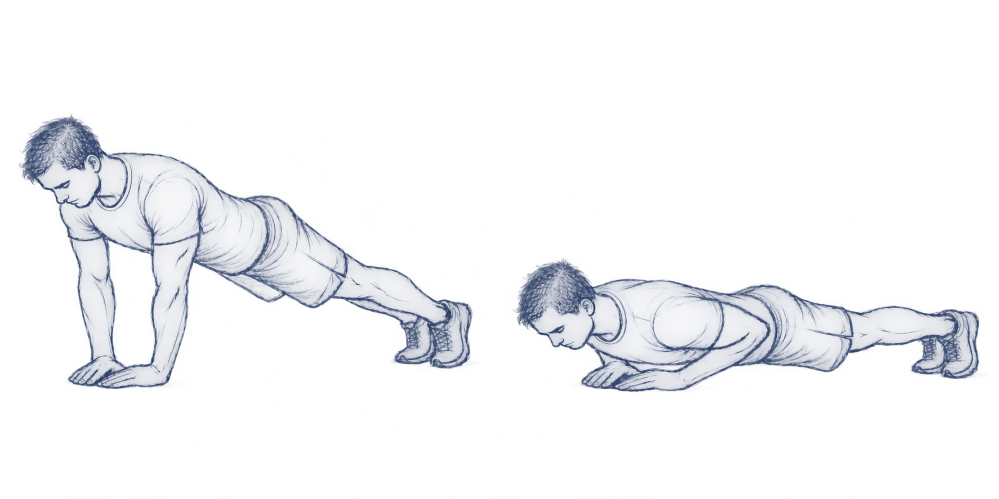

| Ausführung | Leichter | Schwerer | Fokus |
|---|---|---|---|
| Hände unter den Schultern oder enger unter der Brust aufsetzen. Körper von Kopf bis Fuß stabil halten, Ellenbogen eng führen, Brust kontrolliert absenken und wieder hochdrücken. | Hände erhöht auf einer stabilen Fläche | Füße erhöht | Brust, Trizeps, vordere Schulter, Rumpfspannung |

#### 02 · Pull-ups oder Chin-ups

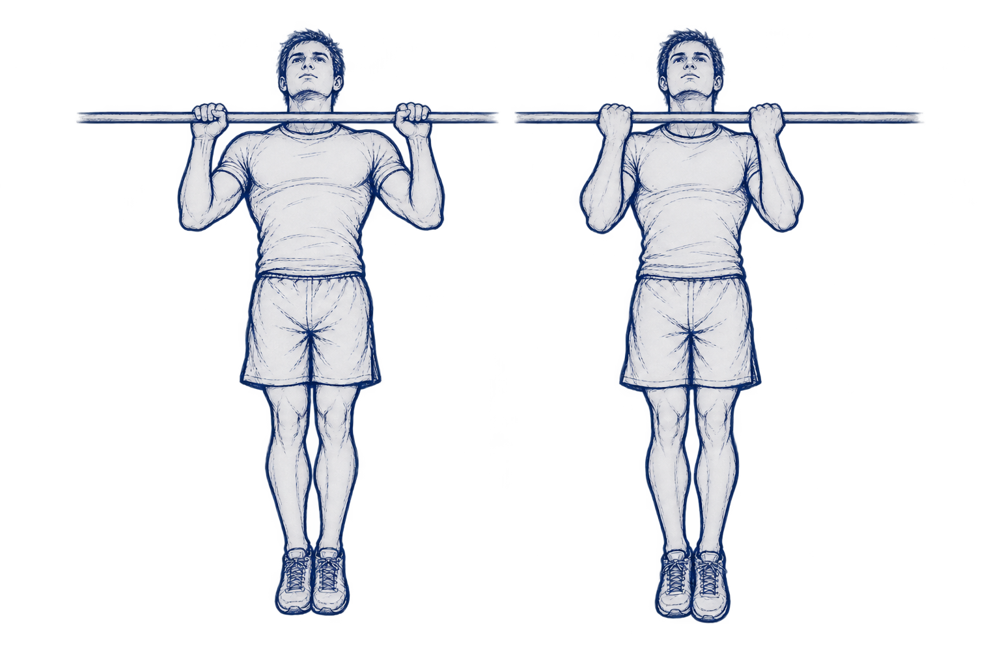

| Ausführung | Griffwahl | Technikhinweis | Fokus |
|---|---|---|---|
| Aus dem gestreckten Hang Körperspannung aufbauen, Schultergürtel aktivieren und kontrolliert ziehen, bis das Kinn die Stange passiert. Langsam absenken. | Pull-up: Handflächen nach vorn; Chin-up: Handflächen zum Körper. Die angenehmere Variante wählen. | Ellenbogen nach unten führen und nicht mit Schwung starten. | Rücken, Armbeuger, Griffkraft, Schulterblattkontrolle |

#### 03 · Dips

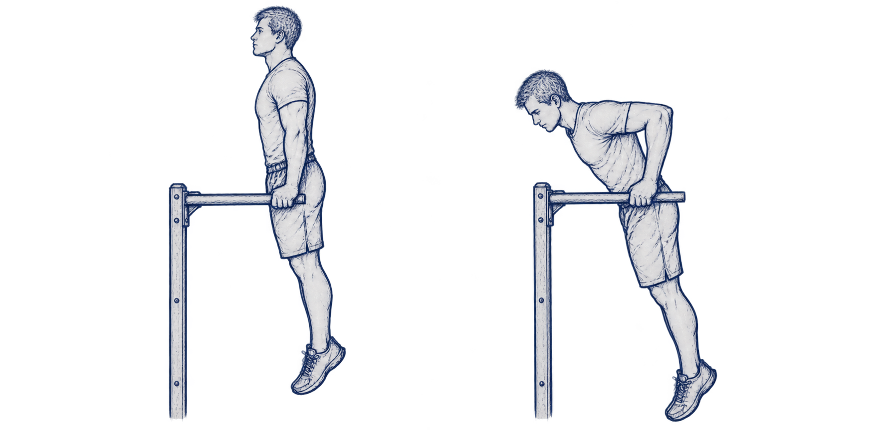

| Ausführung | Aufbau | Technikhinweis | Fokus |
|---|---|---|---|
| Im Stütz zwischen zwei stabilen Barren starten. Ellenbogen beugen, Körper kontrolliert absenken und wieder hochdrücken. | Die Barren sollen ungefähr Unterarmlänge plus Handbreite auseinanderliegen. | Schultern, Ellenbogen und Handgelenke stabil ausrichten; nur so tief gehen, wie die Position kontrolliert bleibt. | Brust, Trizeps, Schultergürtel, Stützkraft |

### Level 1: Dragon Flag

**Voraussetzung laut Artikel:** etwa 10–12 enge Push-ups und 5 Klimmzüge. **Dosierung:** jede Übung 5 Sekunden halten, 5 Wiederholungen in 3 Sätzen; zuerst die passende Vorstufe trainieren.[^calisthenics]

#### Einstieg · Advanced Tucked Dragon Flag

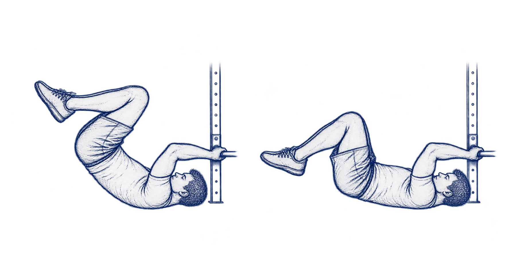

#### Fortgeschritten · One-Leg Dragon Flag

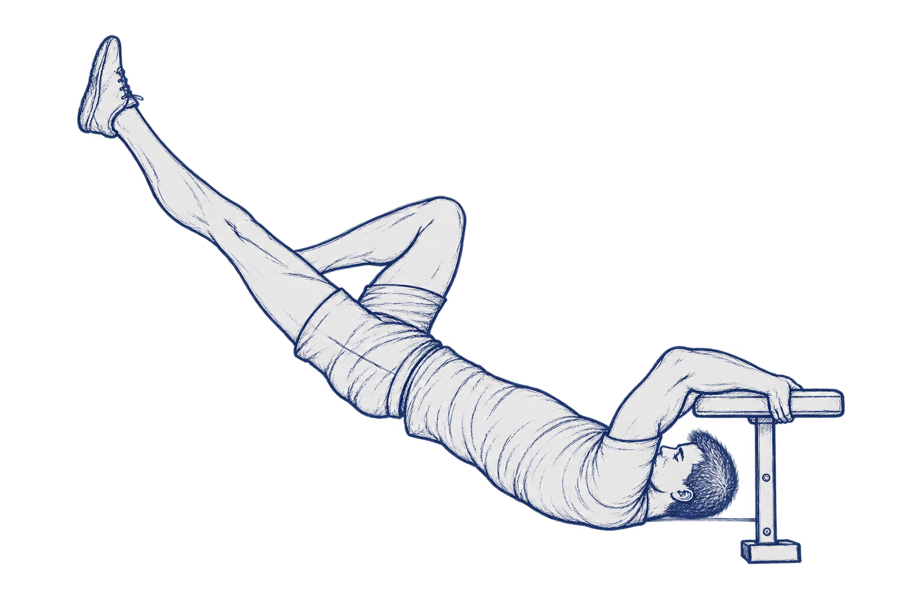

#### Ziel · Dragon Flag

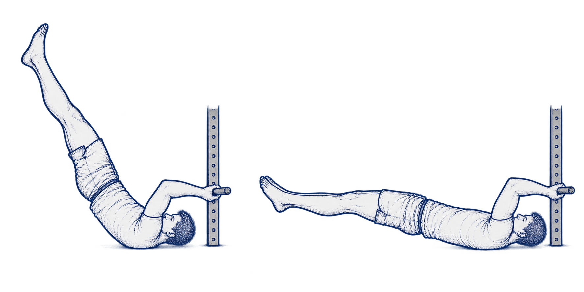

| Stufe | Übung | Kurzbeschreibung | Weiter, wenn … |
|---|---|---|---|
| Einstieg | Advanced Tucked Dragon Flag | Rückenlage vor einer niedrigen, stabilen Stange. Knie und Hüfte gebeugt halten, Fersen zum Gesäß ziehen, Rumpf bis zu den Schulterblättern anheben und kontrolliert absenken. | jede Wiederholung gleichmäßig und ohne Ablegen gelingt |
| Fortgeschritten | One-Leg Dragon Flag | Eine Seite bleibt gebeugt, das andere Bein wird gestreckt; Seiten abwechseln und die Hüfte stabil halten. | 4–6 kontrollierte Tuck-Wiederholungen sicher gelingen |
| Ziel | Dragon Flag | Beine gestreckt anheben, Körper bis zu den Schulterblättern aufrichten und als Linie kontrolliert bis knapp über den Boden absenken. | 5 Sekunden ohne Hüftknick und ohne Schwung gehalten werden |

> **Technikanker:** Nicht im Nacken hängen. Der Druck entsteht über Hände, oberen Rücken und Rumpf; die Hüfte bleibt während des Absenkens gestreckt.

### Level 2: Bent-Arm-Planche

**Dosierung aus dem Artikel:** 10–15 Sekunden halten, möglichst 3 Sätze. Erst zur nächsten Stufe wechseln, wenn die Haltezeit kontrolliert und nahezu mühelos gelingt.[^calisthenics]

#### Einstieg · Tucked Bent-Arm Planche

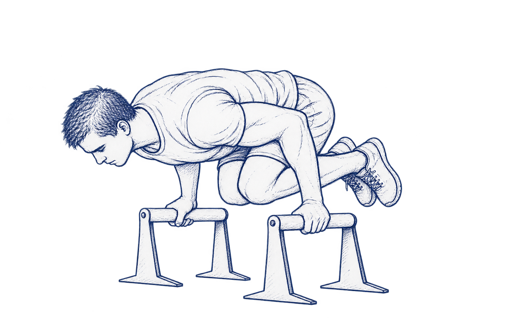

#### Fortgeschritten · One-Leg Bent-Arm Planche

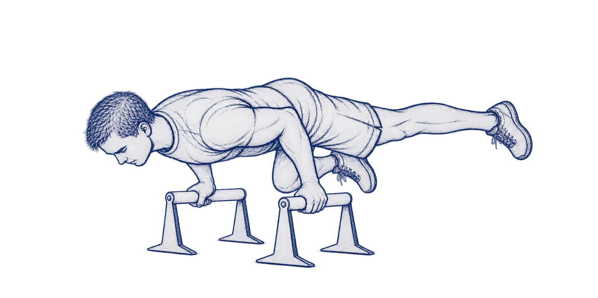

#### Ziel · Bent-Arm Planche

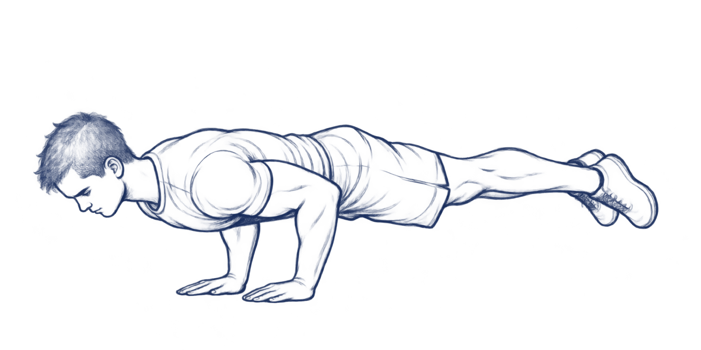

| Stufe | Übung | Kurzbeschreibung | Progression |
|---|---|---|---|
| Einstieg | Tucked Bent-Arm Planche | Auf Parallettes stützen, Ellenbogen eng am Körper, Oberkörper nach vorn verlagern, Knie zur Brust und Fersen zum Gesäß ziehen. Erst ein, dann beide Füße lösen. | Knie allmählich weiter nach hinten führen |
| Fortgeschritten | One-Leg Bent-Arm Planche | Aus der Tuck-Position ein Bein nach hinten strecken, halten, zurückführen und Seite wechseln. | längere saubere Haltezeit, ohne die Schulterposition zu verlieren |
| Ziel | Bent-Arm Planche | Gewicht nach vorn auf die Hände verlagern, Ellenbogen seitlich stützen und nacheinander beide Beine nach hinten strecken. | 10–15 Sekunden stabile Linie und kontrollierter Ausstieg |

> **Gerätehinweis:** Der Artikel empfiehlt erhöhte Parallettes, weil sie mehr Platz geben und die Handgelenksposition erleichtern können. Nur kippsichere Griffe auf rutschfestem Untergrund verwenden.

### Level 3: Front Lever

**Dosierung aus dem Artikel:** 3–5 Sekunden pro Seite in 3 Sätzen. Bei 10 Sekunden kontrollierter Haltezeit zur nächsten Stufe wechseln.[^calisthenics]

#### Einstieg · Tucked Front Lever

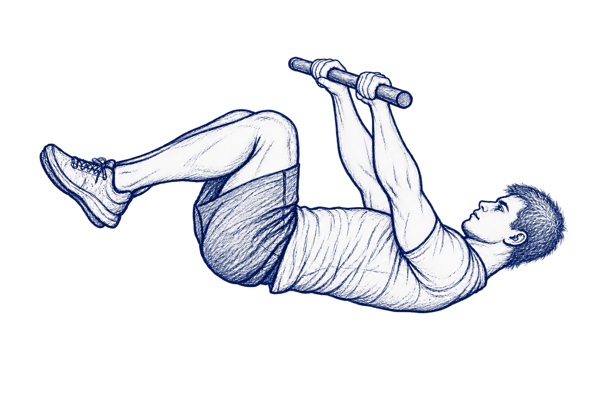

#### Fortgeschritten · Super Advanced Tucked Front Lever

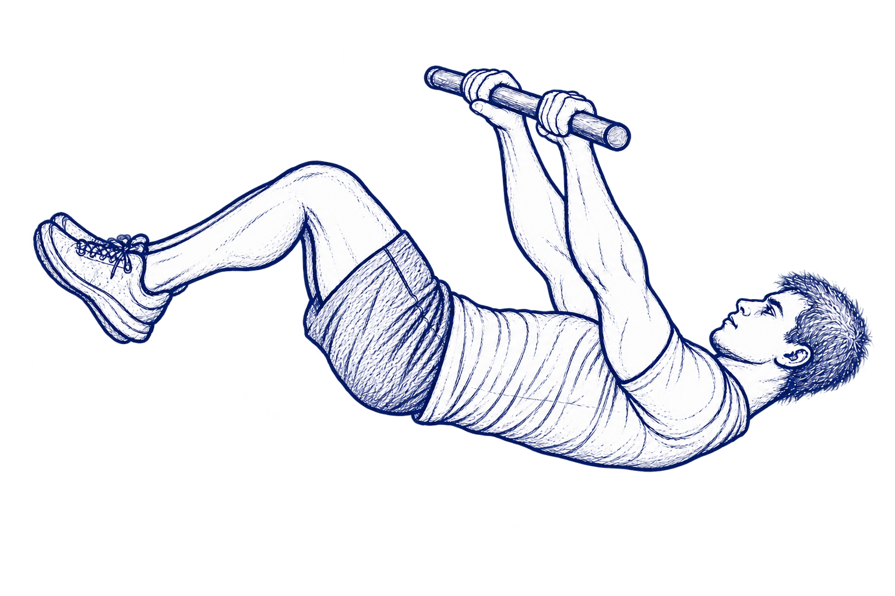

#### Sehr fortgeschritten · One-Leg Front Lever

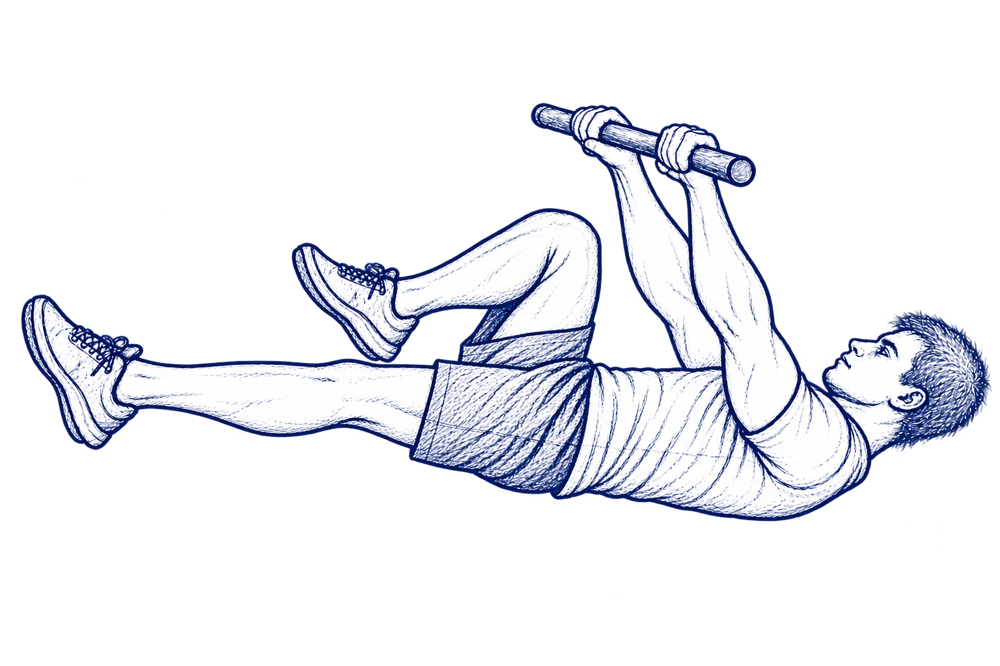

#### Ziel · Front Lever

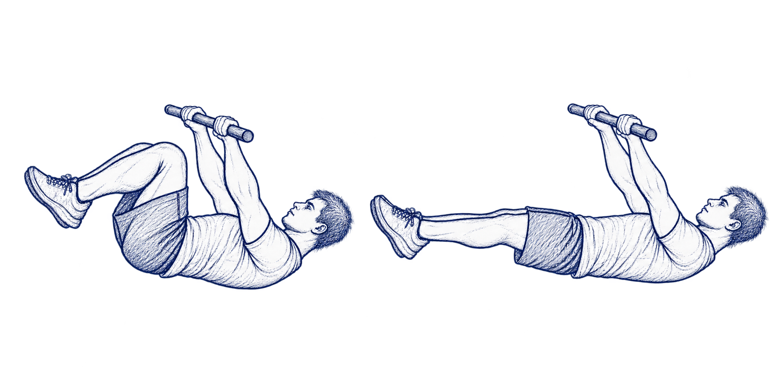

| Stufe | Übung | Kurzbeschreibung | Progression |
|---|---|---|---|
| Einstieg | Tucked Front Lever | Schulterbreit oder etwas enger greifen, beide Knie zur Brust ziehen, Fersen zum Gesäß und Arme gestreckt halten. Die Stange gedanklich Richtung Hüfte drücken. | horizontale Lage zunächst in kleinen, sauberen Portionen halten |
| Fortgeschritten | Super Advanced Tucked Front Lever | Aus dem Tuck die Knie vom Brustkorb wegschieben, bis zwischen Oberkörper und Oberschenkeln ungefähr 120 Grad entstehen. | Winkel schrittweise vergrößern |
| Sehr fortgeschritten | One-Leg Front Lever | Aus dem erweiterten Tuck ein Bein vollständig strecken, halten und anschließend die Seite wechseln. | das gebeugte Bein weiter nach vorn schieben |
| Ziel | Front Lever | Aus dem kompakten Hang beide Beine strecken, Arme gerade halten und den Körper möglichst waagerecht stabilisieren. | 10 Sekunden ohne Schwung oder Absinken |

> **Sicher trainieren:** Dragon Flags, Planche-Varianten und Front Lever belasten Schultern, Ellenbogen, Handgelenke und Rumpf stark. Nur an fest verankerten Geräten trainieren, keine schmerzhaften Positionen erzwingen und anspruchsvolle Stufen bei Bedarf unter fachkundiger Anleitung lernen. Die im Artikel genannten Zusatzgewichts-Voraussetzungen sind sehr anspruchsvoll und werden hier nicht als notwendiger Einstiegstest übernommen.

### Schneller Trainingsablauf

1. **Aufwärmen:** 5–10 Minuten, anschließend Handgelenke, Schultern und Schulterblätter gezielt vorbereiten.
2. **Basis:** Diamond Push-ups, Pull-ups/Chin-ups und Dips mit sauberer Technik.
3. **Ein Schwerpunkt:** Pro Einheit nur ein Level-Ziel trainieren – Dragon Flag, Bent-Arm-Planche oder Front Lever.
4. **Passende Stufe:** Die Variante wählen, die ohne Schwung und ohne Gelenkschmerz kontrollierbar ist.
5. **Dokumentieren:** Haltezeit, Wiederholungen und gewählte Stufe kurz notieren.
6. **Steigern:** Erst die Qualität und Haltezeit erhöhen, danach die schwierigere Variante wählen.

> **Quelle und Abgrenzung:** Übungsnamen, Reihenfolge, Dosierungen, Coach-Hinweise und die zugrunde liegenden Bewegungsphasen beruhen auf dem Magazinartikel. Die Fotos selbst wurden nicht übernommen. Die einfarbigen Illustrationen, die kompakte Struktur, Formulierungen und zusätzlichen Sicherheitsgrenzen sind eigenständige redaktionelle Aufbereitungen für diesen Routinen-Hub.[^calisthenics]

## Wöchentlich: Ausdauer, Gleichgewicht, Erholung

**Kurzurteil:** Kraft allein reicht nicht. Die WHO empfiehlt zusätzlich Ausdauer und ab 65 Jahren gezieltes Gleichgewichtstraining; ausreichend Schlaf und Ruhetage gehören dazu.[^who][^nsf]

### Ausdauer

**[Fachliteratur]** Die WHO empfiehlt Erwachsenen und Älteren pro Woche 150–300 Minuten moderate oder 75–150 Minuten intensive Ausdaueraktivität oder eine Kombination aus beidem. Dazu kommt Krafttraining für alle großen Muskelgruppen an mindestens zwei Tagen. Lange Sitzzeiten sollen begrenzt werden; jede Bewegung zählt.[^who]

**[Redaktioneller Vorschlag]** So lässt sich das im Alltag unterbringen:

| Variante | Beispiele | Woran man die Intensität erkennt | Beispielwoche |
|---|---|---|---|
| moderat | zügiges Gehen, Radfahren, Schwimmen | Sprechen geht, Singen nicht mehr | 5 × 30 Minuten |
| intensiv | Laufen, Bergauf-Radfahren, Rudern | nur noch kurze Sätze möglich | 3 × 25 Minuten |
| Alltag | Treppen, Wege zu Fuß, Gartenarbeit | – | zählt mit |

Wer Kraft und Ausdauer in derselben Einheit trainiert, macht die Kraftübungen zuerst.[^big5]

### Gleichgewicht

**[Fachliteratur]** Ab 65 Jahren empfiehlt die WHO an mindestens drei Tagen pro Woche vielseitige Aktivität, die funktionelles Gleichgewicht und Kraft verbindet, um die Leistungsfähigkeit zu erhalten und Stürzen vorzubeugen.[^who] Die CDC nennt Tai Chi als evidenzbasiertes Programm zur Sturzprävention.[^steadi-balance]

**[Redaktioneller Vorschlag]** Fünf Minuten genügen, etwa nach dem Krafttraining oder beim Zähneputzen – immer mit einem stabilen Halt in Reichweite:

1. Tandemstand (Ferse an Zehe), 3 × 30 Sekunden, Füße wechseln.
2. Einbeinstand, je Seite 3 × 20 Sekunden.
3. Auf einer Linie gehen, Ferse an Zehe, 2 × 10 Schritte.
4. Steigern: auf weicherem Untergrund stehen oder den Kopf dabei langsam drehen.

### Erholung und Schlaf

**[Fachliteratur]** Die US National Sleep Foundation empfiehlt Erwachsenen von 26 bis 64 Jahren 7–9 Stunden Schlaf, ab 65 Jahren 7–8 Stunden.[^nsf]

**[Redaktioneller Vorschlag]** Zwischen zwei intensiven Krafteinheiten liegt mindestens ein Ruhetag; Pfad A sieht ohnehin zwei nicht aufeinanderfolgende Trainingstage vor.[^big5] An Ruhetagen ist leichte Bewegung erwünscht. Anhaltende Schlafprobleme gehören ärztlich abgeklärt, nicht „wegtrainiert“.

## Ernährung

**Kurzurteil:** Protein ausreichend und über den Tag verteilt; mehr als ausreichend bringt bei gut Versorgten wenig Zusatznutzen. Kreatin ist eine Option zum Training, kein Muss.[^dge][^dge2026]

### Protein im Alltag

**[Buch – verifiziert]** Protein ist eine der drei Säulen des Buches und erhält ein eigenes Kapitel ab S. 158.[^toc] Eine exakte Tagesdosis oder ein verifizierter Ernährungsplan ist aus den zugänglichen Buchquellen nicht belegbar.

| Gruppe | Orientierung pro Tag | Quelle |
|---|---|---|
| gesunde Erwachsene, 19–64 Jahre | 0,8 g pro kg Körpergewicht | DGE[^dge] |
| gesunde Erwachsene ab 65 | 1,0 g pro kg Körpergewicht | DGE[^dge] |
| gesunde Ältere | 1,0–1,2 g pro kg Körpergewicht | PROT-AGE[^protage] |
| Ältere mit akuter oder chronischer Erkrankung | häufig 1,2–1,5 g pro kg, individuell und unter Beachtung der Nierenfunktion | PROT-AGE[^protage] |

**[Redaktioneller Vorschlag]** Rechenbeispiel: 75 kg × 1,0 g = 75 g Protein pro Tag, verteilt auf zwei bis drei Mahlzeiten – so wie Anker 4 der Morgenroutine es vorsieht.

Wichtig sind die Grenzen:

- Mehr Protein allein ersetzt keinen Trainingsreiz.
- Bei bereits ausreichender Versorgung ist zusätzlicher Nutzen nicht automatisch zu erwarten. Ein aktueller DGE-Bericht bewertet eine pauschal erhöhte Proteinzufuhr zur Primärprävention von Sarkopenie bei gesunden, bereits ausreichend versorgten Menschen über 50 zurückhaltend.[^dge2026]
- Bei Adipositas sollte eine g/kg-Berechnung nicht unkritisch auf das tatsächliche Körpergewicht angewendet werden; die DGE bezieht ihren Referenzwert auf Normalgewicht.[^dge]
- Bei chronischer Nierenerkrankung, Dialyse, Lebererkrankung, Mangelernährung oder starkem Gewichtsverlust gelten besondere medizinische beziehungsweise ernährungstherapeutische Regeln.
- Proteinreiche Lebensmittel können tierischen oder pflanzlichen Ursprungs sein. Hülsenfrüchte, Sojaprodukte, Vollkorngetreide, Milchprodukte, Eier, Fisch und Fleisch sind mögliche Quellen; ein Supplement ist nicht grundsätzlich nötig.[^dge]

### Kreatin (optional)

#### Was Gießing sagt

**[Buch – verifiziert]** Kreatin ist die dritte Säule und Gegenstand eines eigenen Kapitels ab S. 174.[^toc] Verlagsmaterial und Interviews stellen es als Unterstützung des Muskelstoffwechsels und Trainings dar. In einem Interview werden 3 g täglich genannt; diese Zahl ist als Interviewaussage, nicht als verifizierter Buchwortlaut zu behandeln.[^mark]

#### Was die Evidenz hergibt

**[Fachliteratur]** Kreatinmonohydrat erhöht die intramuskulären Kreatin-/Phosphokreatinspeicher und kann die Leistung bei kurzen, intensiven Belastungen verbessern. In einer Metaanalyse mit 721 älteren Teilnehmenden führte Kreatin **zusätzlich zu Krafttraining** im Mittel zu größeren Zuwächsen an fettfreier Masse (ca. 1,37 kg) sowie kleinen zusätzlichen Kraftgewinnen gegenüber Placebo.[^creatine-meta] Die internationale sporternährungswissenschaftliche Positionsliteratur bewertet Kreatinmonohydrat bei gesunden Menschen in üblichen Dosierungen als gut untersucht und im Allgemeinen gut verträglich.[^creatine-safety]

Einordnung und Vorsicht:

- Am besten belegt ist Kreatin **in Kombination mit Training**, nicht als Ersatz dafür.
- Ein anfänglicher Gewichtsanstieg kann teilweise durch mehr Wasser in der Muskulatur entstehen; fettfreie Masse ist nicht identisch mit neu gebildetem Muskelprotein.
- Kognitive, neuroprotektive und „Anti-Aging“-Wirkungen sind interessante Forschungsfelder, aber deutlich weniger gesichert als Kraft-/Leistungseffekte.
- Kreatinin im Blut kann unter Kreatineinnahme steigen und die geschätzte Nierenfunktion verfälschen, ohne dass zwingend ein Nierenschaden vorliegt. Ärztinnen und Ärzte sollten die Einnahme kennen.
- Bei bekannter Nierenerkrankung, Schwangerschaft/Stillzeit, komplexer Medikation oder unklaren Laborwerten ist vor Supplementierung medizinischer Rat sinnvoll.
- Nahrungsergänzungsmittel durchlaufen kein Arzneimittel-Zulassungsverfahren; Produktreinheit und Deklaration verdienen deshalb Aufmerksamkeit.[^bfr]

## Fortschritt messen

**Kurzurteil:** Einmal pro Quartal zeigen ein paar einfache Tests, ob die Routinen wirken. Es sind Screening-Werkzeuge aus der Altersmedizin, keine Diagnose; die Richtwerte gelten für Menschen ab 60. Für Jüngere zählt vor allem der eigene Verlauf.[^steadi-chair][^ewgsop2]

### Die Tests

| Test | So geht's | Richtwert | Quelle |
|---|---|---|---|
| 30-Sekunden-Aufstehtest | Stuhl ohne Armlehnen, Sitzhöhe etwa 43 cm, Arme vor der Brust gekreuzt. Zählen, wie oft man in 30 Sekunden ganz aufsteht; wer bei Zeitende mehr als halb oben ist, zählt mit. | siehe Tabelle unten | CDC STEADI[^steadi-chair] |
| Vier-Stufen-Gleichgewichtstest | Je 10 Sekunden: Füße nebeneinander, Halbtandem, Tandem (Ferse an Zehe), Einbeinstand – ohne die Füße zu bewegen, Halt in Reichweite. | Tandemstand unter 10 Sekunden: erhöhtes Sturzrisiko | CDC STEADI[^steadi-balance] |
| Fünfmal Aufstehen | Zeit für fünf vollständige Aufsteh-Wiederholungen ohne Armeinsatz. | über 15 Sekunden: Hinweis auf geringe Beinkraft | EWGSOP2[^ewgsop2] |
| Gehtempo (optional) | 4 Meter im normalen Tempo gehen, Zeit messen; Tempo = 4 ÷ Sekunden. | 0,8 m/s oder langsamer: Hinweis auf geringe körperliche Leistungsfähigkeit | EWGSOP2[^ewgsop2] |

**30-Sekunden-Aufstehtest: unterdurchschnittliche Werte nach CDC**[^steadi-chair]

| Alter | Männer | Frauen |
|---|---|---|
| 60–64 | unter 14 | unter 12 |
| 65–69 | unter 12 | unter 11 |
| 70–74 | unter 12 | unter 10 |
| 75–79 | unter 11 | unter 10 |
| 80–84 | unter 10 | unter 9 |
| 85–89 | unter 8 | unter 8 |
| 90–94 | unter 7 | unter 4 |

### So dokumentieren

**[Redaktioneller Vorschlag]** Pro Quartal eine Zeile: Datum, Testwerte, aktueller Trainingspfad, Körpergewicht, Beschwerden. Ziel ist der eigene Verlauf; die Richtwerte sind Untergrenzen für Ältere, kein Leistungsziel. Liegt ein Wert darunter oder verschlechtert er sich deutlich, ist das ein Anlass für ein ärztliches oder physiotherapeutisches Gespräch.

## Warum das wirkt

> **Kurzurteil:** Jürgen Gießings Ratgeber stellt Muskelkraft und Krafttraining als zentrale, praktisch beeinflussbare Faktoren gesunden Alterns dar. Diese Grundidee ist wissenschaftlich gut gestützt. Deutlich vorsichtiger zu lesen sind starke Formulierungen wie „Alterungsprozess umkehren“ oder die Übertragung einzelner Trainings-, Protein- und Kreatinbefunde auf eine umfassende biologische Verjüngung. Die beste Evidenz betrifft Muskelkraft und Alltagsfunktion; für Muskelmasse, Knochen, Stoffwechsel, Kognition und Lebensdauer sind die Effekte je nach Endpunkt kleiner, uneinheitlicher oder nur beobachtend belegt.

#### Was mit HIT gemeint ist

**[Autor – Interview]** Gießings öffentlich beschriebener Ansatz lässt sich als zeiteffizientes, anstrengendes Krafttraining zusammenfassen: wenige, kontrolliert ausgeführte Übungen beziehungsweise Sätze, hohe lokale Anstrengung und ausreichende Erholung. In einem längeren Podcast werden zwei Einheiten pro Woche von jeweils etwa 30–45 Minuten, Ganzkörpertraining, die Beanspruchung schneller Typ-II-Muskelfasern und ein vorsichtiger Einstieg als zentrale Punkte genannt.[^mark]

**Abgrenzung:**

- **HIT:** hochintensives Krafttraining mit Widerstand, in der Regel langsamer und kontrollierter als explosive Intervallarbeit.
- **HIIT:** hochintensives Intervalltraining, meist zyklisch oder ausdauerorientiert, mit Belastungs- und Erholungsintervallen.

#### Wissenschaftliche Einordnung

**[Fachliteratur]** Krafttraining ist klar wirksam. Eine Metaanalyse von 22 randomisierten Studien mit sehr alten Erwachsenen fand deutliche Kraftzuwächse und kleinere Zuwächse der Muskelgröße; auch Menschen ab 80 profitierten.[^veryold] Neuere Metaanalysen bei Sarkopenie zeigen konsistente Verbesserungen von Kraft und körperlicher Funktion, während die Effekte auf gemessene Muskelmasse kleiner oder je nach Messmethode nicht signifikant sind.[^rt2024][^dose]

Für die **spezifische Überlegenheit eines minimalistischen HIT-Modells** ist die Evidenz schwächer:

- Eine große Netzwerk-Metaanalyse fand, dass viele Kombinationen aus Last, Satzanzahl und Häufigkeit Kraft und Muskelaufbau verbessern. Für Maximalkraft rangierten hohe Lasten, mehrere Sätze und häufigeres Training am höchsten; für Hypertrophie ebenfalls eher Mehrsatzprogramme.[^prescription]
- Eine Volumen-Metaanalyse bei älteren Menschen fand Vorteile höheren gegenüber niedrigerem Trainingsvolumen, besonders für Kraft nach längeren Interventionen.[^volume]
- Training bis zum momentanen Muskelversagen war in Metaanalysen **nicht erforderlich**, um Kraft oder Muskelmasse aufzubauen. Die Daten stammen überwiegend aus jüngeren Erwachsenen und lassen sich nicht eins zu eins auf Hochbetagte übertragen.[^failure]

**Fazit zum HIT:** HIT kann eine wirksame, zeitsparende und für manche Menschen gut durchhaltbare Form des Krafttrainings sein. Wissenschaftlich gesichert ist vor allem der Nutzen regelmäßig progressiven Krafttrainings – nicht, dass genau ein Satz, Training bis zum völligen Versagen oder eine bestimmte langsame Bewegungsgeschwindigkeit für alle optimal ist.

#### Gießings Studioprogramm „Big 5“ (Interview)

**[Autor – Interview]** In einem Interview zur Veröffentlichung von *Reverse Aging* empfiehlt Gießing als minimalistisches Ganzkörperprogramm fünf geführte Geräteübungen. Vorgesehen sind zwei Einheiten pro Woche an nicht aufeinanderfolgenden Tagen, beispielsweise Montag und Donnerstag. Pro Übung wird nach dem Erlernen der Technik ein Arbeitssatz mit ungefähr 10–15 langsamen, sauberen Wiederholungen beschrieben; eine Wiederholung dauert dort etwa sieben Sekunden. Die Einheit soll rund 30 Minuten beanspruchen.[^big5]

| Reihenfolge | Übung | Hauptsächlich beansprucht | Vorgabe aus dem Interview |
|---|---|---|---|
| 1 | Beinpresse | Oberschenkel und Gesäß | 1 Arbeitssatz, etwa 10–15 kontrollierte Wiederholungen |
| 2 | Brustpresse | Brust, Schulter, Trizeps | 1 Arbeitssatz, etwa 10–15 kontrollierte Wiederholungen |
| 3 | Latzug | breiter Rücken, Armbeuger | 1 Arbeitssatz, etwa 10–15 kontrollierte Wiederholungen |
| 4 | Rückenstrecker | unterer Rücken/Rumpfrückseite | 1 Arbeitssatz, etwa 10–15 kontrollierte Wiederholungen |
| 5 | Bauchpresse | Bauch- und Rumpfmuskulatur | 1 Arbeitssatz, etwa 10–15 kontrollierte Wiederholungen |

**Beispielwoche:** Montag Ganzkörpertraining; Dienstag/Mittwoch Erholung oder leichte Bewegung; Donnerstag Ganzkörpertraining; Freitag bis Sonntag Erholung oder leichte Bewegung. Optional nennt Gießing Rudern am Gerät/Kabelzug und Beinbeugen als Erweiterungen. Wird Kraft- mit Ausdauertraining in derselben Einheit kombiniert, empfiehlt er Kraft vor Ausdauer.[^big5]

**Wichtig zur Intensität:** Der Zeitungsbeitrag beschreibt den Arbeitssatz bis zur lokalen Erschöpfung. In einem weiteren Interview erklärt Gießing zugleich, dass für einen wirksamen Trainingsreiz ein Abbruch kurz vor dem Muskelversagen ausreichen kann. Dort nennt er außerdem ein allgemeines und ein übungsspezifisches Aufwärmen sowie maximal zehn, meist weniger Übungen in 30–45 Minuten.[^medpertise] Die Fachliteratur bestätigt, dass Training bis zum völligen Versagen nicht notwendig ist.[^failure]

**Einordnung:** Dieses Programm war bis November 2026 Pfad A dieser Seite. Es bleibt hier als Quelle für Gießings Trainingsgrundsätze (wenige, langsame Sätze, Abbruch kurz vor der Erschöpfung, zwei Einheiten pro Woche); der aktuelle Pfad A überträgt diese Grundsätze auf ein Training daheim.

### Wissenschaftliche Evidenz zu zentralen Aussagen

| Aussage | Bewertung | Begründung |
|---|---|---|
| Krafttraining steigert Kraft im hohen Alter | **gut belegt** | Randomisierte Studien und Metaanalysen zeigen deutliche Kraftzuwächse, auch ab 75/80 Jahren.[^veryold] |
| Krafttraining verbessert Alltagsfunktion bei Sarkopenie | **gut bis moderat belegt** | Verbesserungen u. a. bei Ganggeschwindigkeit, Knieextension und Aufstehtests; klinische Relevanz einzelner Effekte ist nicht immer groß.[^dose] |
| Krafttraining baut bei Älteren Muskelmasse auf | **moderat belegt** | Kleine mittlere Effekte; Ergebnis hängt von Messmethode, Dauer, Ausgangslage und Programm ab.[^rt2024][^hypertrophy] |
| Zwei Einheiten pro Woche sind sinnvoll | **gut als Mindest-/Praxisempfehlung gestützt** | WHO empfiehlt Kräftigung an mindestens zwei Tagen; „optimal“ ist individuell und zielabhängig.[^who] |
| HIT ist anderen Krafttrainingsformen überlegen | **nicht allgemein belegt** | Viele Programme wirken; höheres Volumen/mehrere Sätze können Vorteile haben.[^prescription][^volume] |
| Muskelversagen ist nötig | **nicht belegt** | Metaanalysen finden keine notwendige Überlegenheit gegenüber Training ohne Versagen.[^failure] |
| Krafttraining verbessert Glukosekontrolle bei Typ-2-Diabetes | **moderat belegt** | Eine Metaanalyse von 23 Studien fand eine mittlere HbA1c-Senkung von rund 0,34 Prozentpunkten.[^diabetes] |
| Krafttraining schützt Knochen | **moderat, Effekt eher klein** | Metaanalysen zeigen kleine standortspezifische BMD-Effekte; Nutzen ist nicht an jedem Messort nachweisbar.[^bone] |
| Krafttraining verhindert Demenz | **nicht belegt** | Es gibt Hinweise auf Verbesserungen bestimmter kognitiver Tests; daraus folgt kein Nachweis der Demenzprävention.[^cognition] |
| Krafttraining verlängert das Leben | **assoziativ belegt, kausal unsicher** | Beobachtungsdaten verbinden Krafttraining mit geringerer Gesamtsterblichkeit; Selbstselektion und andere Lebensstilfaktoren bleiben möglich.[^mortality] |
| Kreatin verstärkt Trainingseffekte bei Älteren | **moderat belegt** | Im Mittel zusätzliche fettfreie Masse und kleine Kraftvorteile; heterogene Studien.[^creatine-meta] |
| Protein oberhalb der Grundversorgung verhindert Sarkopenie | **uneinheitlich** | Bedarf im Alter kann höher liegen; pauschaler Zusatznutzen bei bereits gut Versorgten ist unklar.[^dge2026] |
| „Reverse Aging“ kehrt das biologische Altern insgesamt um | **nicht belegt** | Verbesserte Kraft, Funktion oder Biomarker sind keine umfassende Rückstellung des biologischen Alters. |

### Was „Reverse Aging“ sinnvoll bedeuten kann – und was nicht

Der Titel funktioniert am besten als **Metapher für reversible oder beeinflussbare Altersfolgen**:

- Kraft kann wieder steigen.
- Muskelgröße und -qualität können sich verbessern.
- Alltagsfunktionen können zurückkehren.
- Glukosekontrolle, Knochendichte oder kognitive Testleistungen können sich je nach Person und Programm verbessern.

Nicht daraus ableitbar sind:

- eine allgemeine Umkehrung des kalendarischen oder biologischen Alters;
- garantierte Prävention von Krebs, Alzheimer, Diabetes oder Osteoporose;
- ein bestimmter Gewinn an Lebensjahren;
- die Aussage, Muskelverlust sei die einzige oder hauptsächliche Ursache des Alterns;
- die Gleichsetzung einzelner Biomarker- oder Genexpressionsänderungen mit klinischer Verjüngung.

Altern ist multikausal. Muskeltraining adressiert einen wichtigen, aber nicht den einzigen beeinflussbaren Bereich. Ausdauer, Gleichgewicht, Schlaf, Ernährung, soziale Faktoren, Tabak-/Alkoholexposition, medizinische Versorgung und Erkrankungen bleiben relevant.

## Anhang: Zum Buch

Der Name dieser Seite geht auf Jürgen Gießings Ratgeber *Reverse Aging* zurück. Dieser Anhang fasst das Buch und seine Rezeption zusammen; Gießings Thesen sind oben als eine Quelle unter mehreren eingearbeitet. Die ausführliche Recherchefassung vom 12. Oktober 2026 bleibt im Quellenarchiv erhalten.

### Quellenstatus und Leseschlüssel

Diese Seite kennzeichnet die Herkunft jeder Aussage:

- **[Buch – verifiziert]**: direkt durch Verlagsseite, Verlags-Presseinformation, öffentlich zugängliche Buchvorschau oder bibliografischen Katalog belegt.
- **[Autor – Interview]**: Aussage Gießings aus einem Interview oder Podcast; sie ist nicht automatisch identisch mit dem Wortlaut des Buches.
- **[Fachliteratur]**: unabhängige Leitlinie, systematische Übersichtsarbeit, Metaanalyse oder Positionspapier.
- **[Magazin]**: Trainingsplan aus einem Publikumsmagazin; Übungen und Dosierungen nach dem Artikel, Darstellung redaktionell.
- **[Redaktioneller Vorschlag]**: praktische Übertragung dieser Seite; kein Inhalt der genannten Quellen.

Die vollständige Druckausgabe lag für diese Recherche **nicht** vor. Daher werden weder nicht einsehbare Unterkapitel noch konkrete Übungsfolgen, Satz-/Wiederholungszahlen oder Ernährungspläne als Buchinhalt ausgegeben. Die Kapitelübersicht unten folgt ausschließlich dem öffentlich sichtbaren Inhaltsverzeichnis.[^toc]

### Bibliografische Angaben

| Feld | Verifizierte Angabe |
|---|---|
| Autor | Prof. Dr. Dr. Jürgen Gießing |
| Titel | *Reverse Aging* |
| Untertitel | *Warum fitte Muskeln unseren Stoffwechsel verjüngen* |
| Vorwort | Prof. Dr. Andreas Michalsen |
| Verlag | Kneipp Verlag, Wien (Verlagsgruppe Styria) |
| Erscheinungsjahr | 2025 |
| Verlagstermin | 15. Dezember 2025 |
| Ausstattung | Hardcover, 13,5 × 21,5 cm |
| ISBN (Print) | 978-3-7088-0874-1 |
| ISBN (E-Book) | 978-3-99040-824-7 |
| Umfang | Verlag: 208 Seiten; Österreichische Nationalbibliothek: 204 Seiten |
| Literaturverzeichnis | Laut Österreichischer Nationalbibliothek: S. 194–197 |
| Preis bei Erscheinen | 24 Euro |

**Hinweis zur Seitenzahl:** Der Verlag nennt 208 Seiten,[^verlag] der Katalog der Österreichischen Nationalbibliothek 204 Seiten.[^onb] Vermutlich zählen die Quellen unterschiedlich (z. B. Titelei/ungezählte Seiten); ohne physisches Exemplar lässt sich die Abweichung nicht abschließend klären.

### Kernaussagen des Buchprojekts

**[Buch – verifiziert]** Aus Klappentext, Presseinformation und öffentlicher Vorschau lässt sich belastbar ableiten:

- Altersbedingter Muskelabbau (Sarkopenie) wird als unterschätztes Gesundheitsproblem dargestellt.
- Muskulatur wird nicht nur als Bewegungsapparat, sondern als stoffwechselaktives Gewebe beschrieben, das Energie speichert und verbraucht, Stoffe aus dem Blut aufnimmt und abgibt sowie Knochen und Kreislauf beeinflusst.[^presse]
- Der praktische Ansatz ruht auf drei Säulen: intensives Muskeltraining, ausreichende Proteinzufuhr und Kreatin.[^verlag]
- Das bevorzugte Trainingsmodell ist HIT (*High-Intensity Training*), nicht HIIT (*High-Intensity Interval Training*).
- Ziel ist nicht Unsterblichkeit. Gießing präzisiert im ZEIT-Interview, es gehe darum, sehr alt und dabei fit zu werden; bestimmte häufig dem Alter zugeschriebene Verluste könnten gebremst, gestoppt oder teilweise umgekehrt werden.[^zeit]

**Nicht verifiziert als exakter Buchinhalt:** einzelne Übungsnamen, ein vollständiger Musterplan, genaue Wiederholungsdauer, Pausen, Progressionsregeln, Proteinmengen pro Mahlzeit und Kreatin-Dosierungen. Solche Details tauchen teilweise in Interviews oder Rezensionen auf, dürfen aber ohne Druckausgabe nicht dem Buch wortgetreu zugeschrieben werden. Der Trainingsbereich dieser Seite weist deshalb für jeden Plan gesondert aus, woher er stammt.

### Autor

Prof. Dr. Dr. Jürgen Gießing ist Sport- und Erziehungswissenschaftler und Professor für Sportwissenschaft am Campus Landau der Rheinland-Pfälzischen Technischen Universität Kaiserslautern-Landau (RPTU). Sein Arbeitsbereich umfasst Trainingswissenschaft und Sportmedizin; seine öffentlichen Schwerpunkte liegen unter anderem auf Muskelaufbau, Krafttraining, HIT und Kreatin.[^rptu] Der Verlag bezeichnet ihn werblich als einen führenden deutschsprachigen Sportwissenschaftler und HIT-Pionier.[^presse] Diese Superlative sind keine unabhängige wissenschaftliche Bewertung.

Relevante weitere Bücher des Autors sind unter anderem *HIT-Fitness* und ein eigener Ratgeber zu Kreatin; sie erklären den fachlichen Hintergrund des neuen Buches, ersetzen aber nicht dessen Quellenprüfung.

### Interviews, Podcasts und Rezensionen

#### Interviews mit dem Autor

- **DIE ZEIT, 18. März 2026:** Gespräch über Muskelabbau, Krafttraining im Alter und die Bedeutung des Titels. Besonders nützlich, weil Gießing dort „Reverse Aging“ auf beeinflussbare körperliche Veränderungen begrenzt.[^zeit]
- **Fitness mit M.A.R.K., 17./18. Februar 2026 (ca. 83 Minuten):** ausführliches Gespräch zu Sarkopenie, HIT versus Volumentraining, Protein, Kreatin, Typ-II-Fasern und Einstieg. Die Shownotes enthalten Kapitelmarken, sind aber journalistisch/werblich zugespitzt.[^mark]
- **ACHILLES RUNNING, 8. Januar 2026 (ca. 66 Minuten):** Krafttraining, Kognition, Trainingshäufigkeit, HIT, Protein und Kreatin; hilfreich als Überblick über Gießings öffentliche Argumentation.[^achilles]
- **Glans und Gloria, 2026 (ca. 69 Minuten):** Sarkopenie, funktionelle Tests, HIT, Kreatin und neurologische Effekte; Kapitelmarken erleichtern die Prüfung einzelner Aussagen.[^glans]
- **HEALTHWISE, 4. Dezember 2024:** vertiefendes Gespräch zu Kreatin. Es geht einem Produktumfeld voraus und sollte daher nicht als unabhängige Evidenzquelle behandelt werden.[^healthwise]

#### Rezensionen

- **LovelyBooks:** derzeit nur eine sehr kleine Zahl von Nutzerbewertungen. Gelobt werden Verständlichkeit und wissenschaftliche Bezüge; kritisiert werden viele Studien/Graphiken und ein als knapp empfundener Übungsteil. Wegen der geringen Fallzahl nicht repräsentativ.[^lovely]
- **buch.yoga:** ausführliche, persönlich gefärbte Besprechung aus Sicht eines Yogalehrers; positiv gegenüber Muskeltraining, aber keine wissenschaftliche Rezension.[^yoga]

**Recherchebefund:** Eine peer-reviewte wissenschaftliche Buchrezension wurde in den geprüften Quellen nicht gefunden. Interviews und Publikumsrezensionen sind nützlich für Rezeptionsgeschichte und Autorpositionen, nicht als Wirksamkeitsnachweis.

### Kritische Gesamtbewertung

#### Stärken

- gesellschaftlich relevantes Thema: Muskelkraft und Selbstständigkeit im Alter;
- klare, handlungsorientierte Struktur;
- Fokus auf eine Intervention mit solider Evidenzbasis;
- Verbindung von Training, Ernährung und Kreatin;
- niedrigere Zeithürde kann die Umsetzbarkeit verbessern.

#### Grenzen

- Titel und Werbesprache sind stärker als der klinische Nachweis einer „Verjüngung“;
- die Evidenz für Krafttraining allgemein ist nicht identisch mit Evidenz für Gießings spezifische HIT-Ausgestaltung;
- stärkeres Training ist nicht für jede Person ohne Anpassung geeignet;
- Protein- und Kreatinempfehlungen brauchen Kontext (Ausgangszufuhr, Erkrankungen, Medikamente, Ziele);
- Effekte auf Krankheiten oder Sterblichkeit dürfen nicht aus Surrogatmarkern abgeleitet werden;
- anekdotische Transformationen aus Interviews sind keine kontrollierten Wirksamkeitsnachweise;
- vollständige Buchbelege und interne Literaturverweise konnten ohne Druckausgabe nicht einzeln geprüft werden.

## Bibliografie und Quellen

### Buch und Primärquellen zum Buch

1. Gießing, Jürgen: *Reverse Aging. Warum fitte Muskeln unseren Stoffwechsel verjüngen*. Wien: Kneipp Verlag, 2025. ISBN 978-3-7088-0874-1.
2. Kneipp/Styria: [Verlagsseite zum Buch](https://www.styriabooks.at/shop/gesundheit-wohlfuehlen/reverse-aging/).
3. Styria Buchverlage: [Presseinformation mit Buchauszug (PDF)](https://www.styriabooks.at/wp-content/uploads/2025/04/PA_Reverse-Aging_Prof.-Dr.-Juergen-Giessingc-Kneipp-Verlag-2025.pdf).
4. Österreichische Nationalbibliothek: [Österreichische Bibliografie 2026/2 (PDF), Eintrag 204](https://www.onb.ac.at/fileadmin/content/onb-dateien/1_Sitemap/Bestaende___Kataloge/Neuerscheinungen/2026/Bibliographie202602.pdf).
5. Morawa: [Öffentliche Buchvorschau mit Inhaltsverzeichnis (PDF)](https://www.morawa.at/annot/564C427C7C36363134613661363731396134396638383866383431383332633666356531667C7C504446.pdf?sq=1).

### Leitlinien, Positionspapiere und systematische Evidenz

6. World Health Organization (2020): [WHO Guidelines on Physical Activity and Sedentary Behaviour](https://iris.who.int/bitstream/handle/10665/336656/9789240015128-eng.pdf).
7. Deutsche Gesellschaft für Ernährung: [Referenzwerte für Protein](https://www.dge.de/wissenschaft/referenzwerte/protein/) und [FAQ Protein](https://www.dge.de/gesunde-ernaehrung/faq/ausgewaehlte-fragen-und-antworten-zu-protein-und-unentbehrlichen-aminosaeuren/).
8. Bauer, J. et al. (2013): [Evidence-based recommendations for optimal dietary protein intake in older people: PROT-AGE](https://pubmed.ncbi.nlm.nih.gov/23867520/). *J Am Med Dir Assoc*, 14(8), 542–559.
9. Grgic, J. et al. (2020): [Effects of Resistance Training on Muscle Size and Strength in Very Elderly Adults](https://pubmed.ncbi.nlm.nih.gov/32740889/). *Sports Medicine*, 50, 1983–1999.
10. Sun, R. et al. (2025): [Effectiveness of resistance training in sarcopenic older adults](https://pubmed.ncbi.nlm.nih.gov/39191151/). *Archives of Gerontology and Geriatrics*, 128, 105595.
11. Chen, N. et al. (2021): [Resistance training in healthy older people with sarcopenia](https://pubmed.ncbi.nlm.nih.gov/34763651/). *European Review of Aging and Physical Activity*.
12. Figueiredo, V. C. et al. (2024): [Different resistance training volumes in older people](https://pubmed.ncbi.nlm.nih.gov/38128241/). Systematic review and meta-analysis.
13. Currier, B. S. et al. (2023): [Resistance training prescription for strength and hypertrophy](https://pubmed.ncbi.nlm.nih.gov/37414459/). *British Journal of Sports Medicine*.
14. Grgic, J. et al. (2022): [Training to repetition failure or non-failure](https://pubmed.ncbi.nlm.nih.gov/33497853/). *Journal of Sport and Health Science*, 11(2), 202–211.
15. Chilibeck, P. D. et al. (2017): [Creatine during resistance training in older adults](https://pubmed.ncbi.nlm.nih.gov/29138605/). *Open Access Journal of Sports Medicine*, 8, 213–226.
16. Kreider, R. B. et al. (2017): [ISSN position stand: safety and efficacy of creatine supplementation](https://jissn.biomedcentral.com/articles/10.1186/s12970-017-0173-z). *Journal of the International Society of Sports Nutrition*, 14, 18.
17. Antonio, J. et al. (2021): [Common questions and misconceptions about creatine supplementation](https://jissn.biomedcentral.com/articles/10.1186/s12970-021-00412-w). *Journal of the International Society of Sports Nutrition*, 18, 13.
18. Ishiguro, H. et al. (2016): [Resistance training and glycemic control in type 2 diabetes](https://pubmed.ncbi.nlm.nih.gov/26604100/). *Sports Medicine*, 46, 67–77.
19. Massini, D. A. et al. (2022): [Resistance training and bone mineral density in older adults](https://pubmed.ncbi.nlm.nih.gov/35742181/). *Healthcare*, 10(6), 1129.
20. Coelho-Junior, H. J. et al. (2022): [Resistance training and cognitive function in older adults](https://pubmed.ncbi.nlm.nih.gov/33325273/). *Aging & Mental Health*, 26(2), 213–224.
21. Saeidifard, F. et al. (2019): [Resistance training and mortality](https://pubmed.ncbi.nlm.nih.gov/31104484/). *European Journal of Preventive Cardiology*, 26(15), 1647–1665.
22. Bundesinstitut für Risikobewertung: [Fragen und Antworten zu Nahrungsergänzungsmitteln](https://www.bfr.bund.de/veroeffentlichung/fragen-und-antworten-zu-nahrungsergaenzungsmitteln/).

### Interviews und Rezeption

23. DIE ZEIT (18.03.2026): [„Krafttraining wird bald so selbstverständlich sein wie Zähneputzen“](https://www.zeit.de/sport/2026-03/muskeln-alter-gesundheit-juergen-giessing).
24. Fitness mit M.A.R.K. (17./18.02.2026): [„Reverse Aging: Mit 80 mehr Muskeln als mit 25“](https://www.marathonfitness.de/reverse-aging-juergen-giessing/).
25. ACHILLES RUNNING (08.01.2026): [„Kraft macht jünger“](https://shows.acast.com/achilles-running-podcast/episodes/anti-aging-mit-krafttraining-mehr-muskeln-langer-leben-mit-p).
26. Glans und Gloria (2026): [„Muskelschwund: Warum er schon mit 30 beginnt“](https://www.podcast.de/episode/707657757/muskelschwund-warum-er-schon-mit-30-beginnt-nicht-erst-im-alter-prof-dr-dr-juergen-giessing).
27. HEALTHWISE (04.12.2024): [„Deep Dive: Kreatin“](https://healthwise.podigee.io/46-new-episode).
28. LovelyBooks: [Nutzerrezensionen zu *Reverse Aging*](https://www.lovelybooks.de/autor/J%C3%BCrgen-Gie%C3%9Fing/Reverse-Aging-18739336437-w/).
29. buch.yoga: [Rezension zu *Reverse Aging*](https://buch.yoga/fitness/reverse-aging/).
30. RPTU: [Profil von Prof. Dr. Dr. Jürgen Gießing](https://nuw.rptu.de/institute/isw/team/professorinnen/prof-dr-dr-juergen-giessing).
31. Frankfurter Rundschau / 24vita (04.01.2026): [„HIT für Muskelaufbau: So trainieren Sie kurz, aber effektiv“](https://www.fr.de/ratgeber/fitness/hit-fuer-muskelaufbau-so-trainieren-sie-kurz-aber-effektiv-zr-94105790.html). Interviewbasierter „Big 5“-Geräteplan im Umfeld der Buchveröffentlichung.
32. Medpertise: [„High-Intensity Training (HIT): Mehr Effekt mit weniger Gewicht“](https://www.medpertise.de/high-intensity-training/high-intensity-training-mehr-effekt-weniger-gewicht-prof-juergen-giessing/). Interview mit Jürgen Gießing zu Aufbau, Intensität und Grenzen des HIT.

---

*Stand der Recherche: 12. Oktober 2026. Diese Seite ist eine quellenkritische Sekundärdarstellung und keine medizinische Diagnose oder individuelle Therapie-/Trainingsanweisung.*

### Ergänzende Quellen für Routinen

1. Centers for Disease Control and Prevention: [STEADI – 30-Second Chair Stand (PDF)](https://stacks.cdc.gov/view/cdc/157303/cdc_157303_DS1.pdf).
2. Centers for Disease Control and Prevention: [STEADI – The 4-Stage Balance Test (PDF)](https://www.cdc.gov/steadi/media/pdfs/STEADI-Assessment-4Stage-508.pdf).
3. Cruz-Jentoft, A. J. et al. (2019): [Sarcopenia: revised European consensus on definition and diagnosis](https://pubmed.ncbi.nlm.nih.gov/30312372/). *Age and Ageing*, 48(1), 16–31.
4. Hirshkowitz, M. et al. (2015): [National Sleep Foundation's updated sleep duration recommendations: final report](https://doi.org/10.1016/j.sleh.2015.10.004). *Sleep Health*, 1(4), 233–243.
5. Steinbach, Martina: „Häng dich rein!“, *Men's Health*, 14.10.2026, Heftseiten 56–63 (Druckausgabe).

---

*Stand: 3. November 2026. Zusammengeführt aus dem Routinen-Hub und dem quellenkritischen Reverse-Aging-Wiki (Recherchestand 12. Oktober 2026). Keine medizinische Diagnose oder individuelle Therapie- oder Trainingsanweisung.*

[^toc]: Morawa, öffentliche Buchvorschau, Inhaltsverzeichnis; zusätzlich durch die Themenliste der Styria-Presseinformation plausibilisiert. Zugriff 12.10.2026.
[^verlag]: Kneipp/Styria, Verlagsseite zu *Reverse Aging*. Zugriff 12.10.2026.
[^onb]: Österreichische Nationalbibliothek, *Österreichische Bibliografie*, 2026/2, Eintrag 204, S. 69.
[^presse]: Styria Buchverlage, Presseinformation *Reverse Aging*, 2025, S. 1–2.
[^zeit]: DIE ZEIT, Interview mit Jürgen Gießing, 18.03.2026.
[^mark]: Fitness mit M.A.R.K., Folge 559, 17./18.02.2026; Angaben anhand der veröffentlichten Shownotes und Kapitelmarken.
[^veryold]: Grgic et al. 2020, PMID 32740889.
[^rt2024]: Sun et al. 2025, PMID 39191151.
[^dose]: Zhang et al. 2025, *Dose-response effects of resistance training in sarcopenic older adults*, PMID 41194011.
[^hypertrophy]: Marzetti et al. 2024, *Lower extremity muscle hypertrophy in response to resistance training in older adults*, PMID 39579806.
[^prescription]: Currier et al. 2023, PMID 37414459.
[^volume]: Figueiredo et al. 2024, PMID 38128241.
[^failure]: Grgic et al. 2022, PMID 33497853; Refalo et al. 2023, PMID 36334240.
[^who]: WHO, *Guidelines on Physical Activity and Sedentary Behaviour*, 2020.
[^dge]: Deutsche Gesellschaft für Ernährung, Referenzwerte und FAQ zu Protein. Zugriff 12.10.2026.
[^protage]: Bauer et al. 2013, PMID 23867520.
[^dge2026]: DGE, Tagungsbericht „Ernährung und Bewegung sind wichtige Stellschrauben für gesundes Altern“, 2026. Die dort referierte Umbrella Review war zum Berichtszeitpunkt noch unveröffentlicht; die Aussage ist daher vorläufig.
[^creatine-meta]: Chilibeck et al. 2017, PMID 29138605.
[^creatine-safety]: Kreider et al. 2017, DOI 10.1186/s12970-017-0173-z; Antonio et al. 2021, DOI 10.1186/s12970-021-00412-w.
[^bfr]: Bundesinstitut für Risikobewertung, FAQ Nahrungsergänzungsmittel. Zugriff 12.10.2026.
[^diabetes]: Ishiguro et al. 2016, PMID 26604100.
[^bone]: Massini et al. 2022, PMID 35742181; O'Bryan et al. 2022, PMID 35608815.
[^cognition]: Coelho-Junior et al. 2022, PMID 33325273; Zheng et al. 2021, PMID 33964318.
[^mortality]: Saeidifard et al. 2019, PMID 31104484. Überwiegend Beobachtungsstudien; Assoziation ist kein sicherer Kausalnachweis.
[^rptu]: RPTU, Profilseite Jürgen Gießing; ergänzend offizielles RPTU-Modulhandbuch mit Gießing als Modulbeauftragtem. Zugriff 12.10.2026.
[^achilles]: ACHILLES RUNNING Podcast, Folge 384, 08.01.2026.
[^glans]: *Glans und Gloria*, Folge 79, 2026; Angaben anhand der veröffentlichten Kapitelmarken.
[^healthwise]: HEALTHWISE, Folge 045, 04.12.2024.
[^lovely]: LovelyBooks, Buchseite und Nutzerrezensionen. Zugriff 12.10.2026.
[^yoga]: buch.yoga, Rezension *Reverse Aging*. Zugriff 12.10.2026.
[^big5]: Frankfurter Rundschau / 24vita, „HIT für Muskelaufbau: So trainieren Sie kurz, aber effektiv“, Stand 04.01.2026. Der Beitrag gibt ein Interview mit Gießing wieder und verknüpft den Plan mit *Reverse Aging*; er ersetzt keine direkte Prüfung der betreffenden Buchseiten.
[^medpertise]: Medpertise, Interview „High-Intensity Training (HIT): Mehr Effekt mit weniger Gewicht“, Zugriff 12.10.2026. Autorenaussagen außerhalb des Buches; kein unabhängiger Wirksamkeitsnachweis.
[^calisthenics]: Martina Steinbach, „Häng dich rein!“, *Men's Health*, 14.10.2026, Heftseiten 56–63. Übungen und Dosierungen nach den Seiten 58–63; für diese Seite gekürzt und neu strukturiert.
[^steadi-chair]: Centers for Disease Control and Prevention, STEADI, *Assessment: 30-Second Chair Stand*, 2017. Unterdurchschnittliche Werte nach Rikli & Jones 1999. Zugriff 03.11.2026.
[^steadi-balance]: Centers for Disease Control and Prevention, STEADI, *Assessment: The 4-Stage Balance Test*, 2017. Zugriff 03.11.2026.
[^ewgsop2]: Cruz-Jentoft, A. J. et al. (2019): *Sarcopenia: revised European consensus on definition and diagnosis* (EWGSOP2). *Age and Ageing*, 48(1), 16–31. Grenzwerte hier nach übereinstimmenden Übersichtstabellen wiedergegeben; der Originalartikel war bei dieser Recherche nicht direkt abrufbar.
[^nsf]: Hirshkowitz, M. et al. (2015): *National Sleep Foundation's updated sleep duration recommendations: final report*. *Sleep Health*, 1(4), 233–243.
